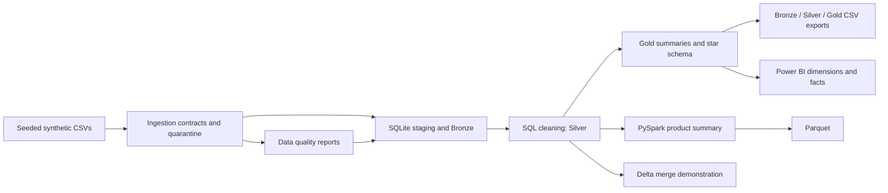

# RetailPulse Data Platform

RetailPulse is a local-first learning project for building a retail data platform from synthetic CSVs. It demonstrates data generation, ingestion, quality checks, SQL transformations, dimensional modeling, medallion exports, Spark, Delta Lake, pipeline monitoring, and Power BI reporting.

## Project status

**Implemented locally:** the SQL pipeline, quality reporting, SQLite star schema, Bronze/Silver/Gold exports, Power BI import files, local run monitoring, and a repeatable SQL performance benchmark. The local automated suite has 13 passing tests. Azure services and Azure Pipelines are documented designs and have not been deployed or run.

The user built **Sales Overview**, **Products & Returns**, and **Inventory** pages in Power BI Desktop. The PBIX is saved locally but is intentionally excluded from Git because its source paths expose the Windows account name. Screenshots are not currently stored in the repository. The DAX measures and build guidance are included; see the [Power BI guide](docs/powerbi.md).

## Architecture



The sample data deliberately contains duplicates, missing values, invalid values, and broken references. A completed pipeline run can therefore have `run_status=success` while `quality_status=failed`. These statuses describe execution and source quality separately. Inventory is snapshot-based and should be filtered to a selected date before aggregating.

## Quick start — Windows PowerShell

Requirements: Git and Python 3.11, 3.12, or 3.13. The project supports Python `>=3.11,<3.14`. From the repository root, use these commands for a first-time setup. If `.venv` already exists, skip the environment-creation command:

```powershell
py -3.13 -m venv .venv
.\.venv\Scripts\python.exe -m pip install --upgrade pip
.\.venv\Scripts\python.exe -m pip install -r requirements.txt
.\.venv\Scripts\python.exe -m retailpulse --help
```

Use the `.venv` interpreter directly; PowerShell activation is optional. This also avoids execution-policy problems when `Activate.ps1` is blocked.

If the default sample has not been generated, create it with:

```powershell
.\.venv\Scripts\python.exe generate_data.py
```

Generation overwrites the eight files in `data/raw`. Inputs are synthetic and ignored by Git. The generator defaults to seed `42` and reference date `2025-12-31`; see [data dictionary](docs/data_dictionary.md) for fields, grains, and intentional defects.

Run the local SQL pipeline:

```powershell
.\.venv\Scripts\python.exe run_sql.py
```

It writes a SQLite database, quality reports, a run summary, layer exports, and Power BI model CSVs under `data/processed/`. Run and freshness history is appended to `data/processed/monitoring/pipeline_runs.csv`. For a full walkthrough see [SQL transformations](docs/sql_walkthrough.md), [data quality](docs/data_quality.md), and [medallion layers](docs/medallion.md).

## Current local evidence

The default sample has 8 source files totaling 6,990,977 bytes and 96,520 rows. The latest recorded quality run evaluated 106 rules: 66 passed and 40 failed. Failed-row counts sum across rules, so one record may contribute more than once. The SQL pipeline completed with zero star-schema foreign-key violations.

The Phase 16 benchmark ran the full local SQL pipeline three times in isolated output folders. Durations were 4.056, 4.014, and 4.050 seconds (median 4.050 seconds). Each run wrote a 44,019,712-byte SQLite database and 74,188,635 bytes of processed output. These measurements describe the recorded Windows environment only; see [performance baseline](docs/performance.md) and the machine-specific ignored JSON report under `work/performance/`.

The local test suite most recently completed with **13 passed**. See [testing guide](docs/testing.md) for coverage and the test command. Azure Pipelines is not connected to an organization or hosted agent.

## Optional local examples

Install and run the PySpark example:

```powershell
.\.venv\Scripts\python.exe -m pip install -e ".[spark]"
.\.venv\Scripts\python.exe run_spark.py
```

Run the Delta Lake merge demonstration after installing its optional dependencies:

```powershell
.\.venv\Scripts\python.exe -m pip install -e ".[delta]"
.\.venv\Scripts\python.exe run_delta.py
```

Spark, Delta, and Power BI setup details and measured limitations are documented in [PySpark](docs/pyspark.md), [Delta Lake](docs/delta_lake.md), and [Power BI](docs/powerbi.md). Databricks notebooks are source examples only; they have not been run in a workspace.

## Repository map

| Path | Contents |
| --- | --- |
| `src/retailpulse/` | Generator, ingestion, quality, SQL, Spark, and Delta implementations |
| `sql/` | Version-controlled staging, cleaning, analytics, medallion, and model SQL |
| `tests/` | Deterministic unit and integration coverage |
| `data/` | Local raw and processed data; generated files are ignored by Git |
| `dashboards/powerbi/` | Saved local `.pbix` report and DAX measure source |
| `notebooks/databricks/` | Portable Databricks notebook source examples |
| `docs/` | Architecture, data contracts, quality, operations, and phase guides |
| `benchmark_sql.py` | Repeatable, isolated end-to-end SQL performance benchmark |
| `pipelines/`, `azure-pipelines.yml` | Local CI/CD design artifacts; no hosted run is claimed |

## Documentation

- [Architecture](docs/architecture.md) and [Azure target design](docs/azure_architecture.md)
- [Data dictionary](docs/data_dictionary.md), [star schema](docs/data_model.md), and [quality rules](docs/data_quality.md)
- [Ingestion](docs/ingestion.md), [SQL walkthrough](docs/sql_walkthrough.md), and [medallion exports](docs/medallion.md)
- [Automated testing](docs/testing.md), [monitoring](docs/monitoring.md), and [performance benchmark](docs/performance.md)
- [Consolidated final metrics](docs/final_metrics.md)
- [CV project entry](docs/cv_entry.md)
- [Power BI model and report](docs/powerbi.md), [PySpark](docs/pyspark.md), [Delta Lake](docs/delta_lake.md), and [Databricks](docs/databricks.md)
- [DevOps guidance](docs/devops.md), [technical decisions](docs/technical_decisions.md), and [full phase roadmap](docs/phase-0-requirements.md)
- [GitHub portfolio checklist](docs/github_portfolio.md)

## Scope and limits

RetailPulse uses fictional synthetic data. It is an educational local implementation, not a production retail platform. It does not include authentication, real customer data, cloud deployment, cost estimates, currency conversion, tax accounting, or production orchestration. Azure resources and hosted CI require separate setup and approval.
