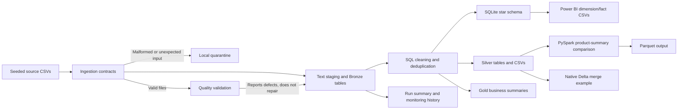

# RetailPulse architecture

RetailPulse is a local-first data engineering learning project. The local path is implemented with Python, CSV, SQLite, PySpark, and the Delta Lake Python bindings. The Azure architecture is a future design; no Azure or Databricks resources have been deployed.

## Local data flow

Ingestion checks expected filenames, headers, and CSV structure. The quality
validator then checks business values while preserving the source files. The
SQL runner builds text staging and Bronze tables, cleans data into typed Silver
tables, creates the analytics and star-schema models, checks foreign keys, and
exports Bronze, Silver, Gold, and Power BI model files. Quality reports
intentionally can fail while the pipeline run succeeds.

The Spark example reads Silver exports and recomputes the Gold product summary
for comparison before writing Parquet. The Delta example independently
demonstrates an incremental merge and time travel using the native Delta Lake
Python bindings; it is not a Spark Delta connector demonstration.

## Runtime and outputs

- Source CSVs and generation metadata: `data/raw/`
- Local SQLite database and pipeline summary: `data/processed/`
- Machine-readable quality reports: `data/processed/quality/`
- Layer exports: `data/processed/bronze/`, `silver/`, and `gold/`
- Power BI dimensions and facts: `data/processed/powerbi_model/`
- Append-only SQL run history: `data/processed/monitoring/pipeline_runs.csv`
- Isolated benchmark evidence: `work/performance/` (ignored by Git)

See [data dictionary](data_dictionary.md), [data model](data_model.md),
[data quality](data_quality.md), [monitoring](monitoring.md), and
[performance](performance.md) for interfaces and evidence.

## Power BI and cloud status

The seven-file dimensional import interface and DAX guidance are implemented.
The user built three report pages in Power BI Desktop. The PBIX is saved locally
but ignored by Git because its CSV paths expose the Windows account name;
screenshots are not stored in this repository. See [Power BI guide](powerbi.md).

The [Azure target architecture](azure_architecture.md) describes ADLS Gen2,
Azure Databricks, Unity Catalog, Jobs, Key Vault, Azure Monitor, and cost
controls. The [Databricks notebooks](databricks.md) are portable source
examples only. No cloud account, workspace, storage, compute, pipeline, or
hosted CI run has been configured by this project.
