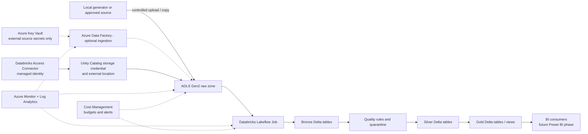

# Phase 11 — Azure target architecture

This document maps the verified local RetailPulse project to a possible Azure deployment. The Azure services below are **designed targets only**. No Azure tenant, subscription, resource group, storage account, Databricks workspace, network, identity, vault, monitor, or pipeline has been configured or deployed.

## Proposed architecture

ADLS Gen2 uses a hierarchical namespace and holds the durable lake data. Databricks runs Spark transformations and Delta writes. Unity Catalog governs table and external-storage access. The Access Connector identity gives Unity Catalog a managed identity for ADLS access; users do not put storage keys or service-principal secrets in notebooks. [Microsoft's Unity Catalog storage guidance](https://learn.microsoft.com/en-us/azure/databricks/connect/unity-catalog/cloud-storage/storage-credentials) describes the storage credential and external-location pattern.

## Service mapping

| Local RetailPulse capability | Azure target | Design notes |
|---|---|---|
| `data/raw/*.csv` and ingestion reports | ADLS Gen2 raw area | Preserve received files and source metadata. Use an HNS-enabled storage account for directory semantics and ACLs. |
| Bronze/Silver/Gold CSVs and local SQLite | Delta tables on ADLS Gen2, governed through Unity Catalog | Keep Bronze source-preserving; keep invalid or rejected records traceable; publish typed Silver and business-facing Gold tables. |
| `run_spark.py` and Spark transformation | Azure Databricks workspace and compute | Use Databricks Runtime's supported Spark/Delta versions. Choose serverless or policy-governed job compute when the workspace supports it. |
| Local step-by-step `run_sql.py` / `run_spark.py` execution | Lakeflow Job | Start with one Job because the processing stages run in Databricks. Add dependencies and retry policy only as workload needs them. |
| External ingestion or multi-service orchestration (future) | Azure Data Factory | Add ADF when source connectivity, copy, or dependencies across Azure services justify a second orchestrator. Avoid scheduling the same Databricks job from both ADF and Databricks Jobs. |
| `.env.example` / future source credentials | Azure Key Vault | Use managed identity to retrieve external-system credentials. Databricks-to-ADLS table access should use Unity Catalog storage credentials and a Databricks Access Connector, not a notebook secret. |
| Local log files and JSON summaries | Azure Monitor and Log Analytics | Route supported platform diagnostics and job/run events to a workspace. Alert on failures, freshness, and selected quality outcomes. |
| Local `.gitignore`, phase docs, and manual setup | Azure Cost Management | Set a small scoped budget, alerts, tags, and cleanup ownership before starting any paid compute. Budget alerts notify; they do not automatically stop spending. |

ADLS Gen2 combines Blob Storage with hierarchical namespace. Azure RBAC is suitable for account/container-level grants; ACLs can express directory/file access. Use Entra groups for human access and managed identities for service-to-service access. [ADLS ACL guidance](https://learn.microsoft.com/en-us/azure/storage/blobs/data-lake-storage-access-control) explains how RBAC and ACLs work together.

## Orchestration decision

**Initial target: Databricks Lakeflow Job.** RetailPulse's current transformations are Spark/Delta work. One orchestrator reduces duplicate schedules, identities, failure paths, and operating cost.

**Add Data Factory only when needed.** ADF is appropriate if RetailPulse gains external source connectors, copy operations, or cross-service dependencies that do not belong in Databricks. Its managed identity can access Azure services and Key Vault without embedding long-lived credentials. [Data Factory managed identity](https://learn.microsoft.com/en-us/azure/data-factory/data-factory-service-identity) and [Key Vault credential references](https://learn.microsoft.com/en-us/azure/data-factory/store-credentials-in-key-vault) document that pattern.

## Identity and security design

- **People:** use Microsoft Entra groups mapped to workspace, Unity Catalog, and Azure roles. Grant access by job function and environment; avoid broad individual grants.
- **Databricks to ADLS:** create a Databricks Access Connector with a managed identity. Grant only the data-plane permissions needed on the relevant storage scope. Register a Unity Catalog storage credential and external location for external ADLS paths; use Unity Catalog-managed storage for managed tables.
- **ADF to Key Vault or ADLS (if added):** use the Data Factory managed identity and scope permissions to the linked vault/container.
- **Storage boundaries:** separate development and production data accounts or subscriptions. Within the lake, distinguish raw, quarantine, bronze, silver, and gold paths or containers. Protect raw data against accidental overwrite and apply retention/lifecycle policies only after business requirements are known.
- **Network:** keep workspace and storage in a chosen region; assess private networking and private endpoints before production. For HNS-enabled ADLS, Microsoft documents that private endpoints may be required for both `blob` and `dfs` subresources so all operations work. See [ADLS known issues](https://learn.microsoft.com/en-us/azure/storage/blobs/data-lake-storage-known-issues).
- **Secrets:** use Key Vault for secrets needed to connect to external systems. Prefer managed identity where the target service supports it. Never commit credentials or print secret values.
- **Audit and protection:** enable resource diagnostic settings and retain logs according to a stated audit requirement. Consider soft delete, versioning, and recovery expectations before loading valuable data.

This is a baseline design, not a completed threat model. Network topology, private DNS, identity ownership, retention periods, customer-managed encryption keys, disaster recovery, and compliance controls need organization-specific requirements before deployment.

## Monitoring and operations

Use Azure Monitor for metrics, logs, alerts, and action groups; use a Log Analytics workspace for queryable diagnostic logs where supported. Collect only required diagnostic categories and define retention intentionally because ingestion and retention affect cost. Monitor at least:

- Databricks Job success/failure, duration, retries, and last successful completion.
- Source arrival/freshness, row counts, schema/contract failures, quarantine counts, and quality rule outcomes.
- ADLS availability, authorization errors, capacity, and transaction behavior.
- Data Factory activity outcomes if ADF is introduced.
- Azure spend and forecast for the deployment's resource group or subscription.

Azure Monitor supports aggregation, analysis, and alerts across Azure services. See [Azure Monitor documentation](https://learn.microsoft.com/en-us/azure/azure-monitor/).

## Cost drivers and controls

No price estimate is included: region, storage tier/volume, source movement, compute size, runtime, run frequency, network topology, and log retention have not been chosen. Microsoft pricing varies with these inputs; use the [Azure pricing calculator](https://azure.microsoft.com/pricing/calculator/) before approving a deployment.

| Cost area | Main driver | Initial control |
|---|---|---|
| ADLS Gen2 | Stored bytes, access tier, transactions, hierarchical metadata, replication, and data transfer | Keep only the learning dataset; avoid duplicate copies; review retention and tiering; keep storage and compute in one region where possible. |
| Azure Databricks | DBU usage plus provisioned VM compute, managed disks/storage, networking, and selected features | Use a small job workload, short auto-termination/idle windows where applicable, one-time runs, and no always-on interactive cluster. |
| Data Factory (optional) | Activity orchestration, integration-runtime/data-movement execution, and data transfer | Omit until cross-service or external ingestion needs justify it; avoid unnecessary polling and debug runs. |
| Key Vault | Vault operations and optional advanced features | Store only needed secrets; prefer managed identities so no secret is required for Azure-to-Azure access. |
| Azure Monitor / Log Analytics | Data ingestion, query volume, retention, and alerting | Select diagnostic categories deliberately; set retention to an approved period; avoid duplicate log routing. |
| Networking | Private endpoint hours, NAT/gateway, egress, and cross-region transfers | Keep resources regional; only add private networking after network requirements and recurring cost are reviewed. |

Azure Databricks pricing includes DBU and VM charges; [Microsoft's pricing page](https://azure.microsoft.com/pricing/details/databricks/) describes compute components. ADLS is billed for capacity and operations; see [ADLS pricing](https://azure.microsoft.com/pricing/details/storage/data-lake/). ADF orchestration and integration-runtime execution are separate cost drivers; see [Data Factory pricing](https://azure.microsoft.com/pricing/details/data-factory/data-pipeline/).

Configure Cost Management budgets and alerts as notifications, not as hard spending caps. Microsoft's docs state that budget alerts notify but do not stop resources or consumption. See [Cost Management budgets](https://learn.microsoft.com/en-us/azure/cost-management-billing/costs/overview-cost-management).

## Deployment gate and current status

Before deployment, produce a region-specific design and estimate, identify the subscription/owner, confirm identity and network prerequisites, estimate run frequency and size, set a budget and alert recipients, and agree on teardown/retention. Then review the concrete resource plan and obtain explicit approval before creating any resource that can incur charges.

| Capability | Status |
|---|---|
| Local CSV, SQLite, PySpark, Parquet, and delta-rs demo | Implemented and locally exercised in earlier phases. |
| Databricks-compatible notebooks and import guide | Designed in Phase 10; not run in a workspace. |
| ADLS Gen2, Azure Databricks workspace/compute, Lakeflow Job, Unity Catalog, Access Connector, Key Vault, Data Factory, Azure Monitor | Designed targets only; not provisioned or configured. |
| Azure identities, network, secrets, cost estimates, and deployment | Not configured; require user/organization decisions and the separate cost/approval gate. |
