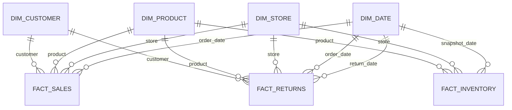

# Phase 6 — RetailPulse star schema

## Model overview

The local SQLite model contains three fact tables and four shared dimensions. A fact row records an event or snapshot at a declared grain; dimensions describe the people, products, locations, or dates used to filter and group facts.

Each dimension has a one-to-many relationship with its fact table. `DimDate` plays multiple roles in `FactReturns`: it identifies both the original order date and the return date. For a BI semantic model, use clearly named date roles or one active and one inactive relationship to avoid ambiguous date filtering.

## Dimensions

### DimCustomer

- **Grain:** one row per cleaned customer.
- **Primary key:** `customer_key` (integer surrogate key).
- **Alternate/business key:** `customer_id` (unique source ID).
- **Important attributes:** first and last name, email, phone, sign-up and birth dates, city, region, loyalty tier.
- **Meaning:** customer attributes used to slice sales and returns. The current implementation is Type 1: it stores the latest cleaned profile and does not preserve attribute history.

### DimProduct

- **Grain:** one row per cleaned product.
- **Primary key:** `product_key`.
- **Alternate/business key:** `product_id` (unique source ID).
- **Important attributes:** SKU, product name, canonical category, subcategory, brand, unit cost, list price, active flag.
- **Meaning:** product hierarchy and descriptive attributes for sales, returns, and inventory analysis.

### DimStore

- **Grain:** one row per cleaned physical/fulfillment store.
- **Primary key:** `store_key`.
- **Alternate/business key:** `store_id` (unique source ID).
- **Important attributes:** name, store type, city, region, country, opened date.
- **Meaning:** location context for orders, returns, and inventory snapshots.

### DimDate

- **Grain:** one row per calendar date in the modeled event range, plus an unknown-date row.
- **Primary key:** `date_key`, formatted as `YYYYMMDD`; `0` is reserved for unknown/unavailable dates.
- **Alternate key:** `date_value`.
- **Important attributes:** calendar year, quarter, month number/name, year-month, day number/name, weekend flag, synthetic as-of-date flag.
- **Meaning:** shared calendar attributes for event and snapshot dates. The source data in this phase has valid dates after SQL cleaning, so the unknown row is available for future handling but is not referenced by current facts.

## Facts

### FactSales

- **Grain:** one row per cleaned order-item line (`order_item_id`).
- **Primary key:** `sales_key` (integer surrogate key); `order_item_id` is unique.
- **Foreign keys:** `order_date_key → DimDate`, `customer_key → DimCustomer`, `product_key → DimProduct`, `store_key → DimStore`.
- **Degenerate identifiers:** `order_id`, `order_item_id`, and `order_status` are retained for traceability and drill-through.
- **Measures:** `quantity`, `unit_price`, `gross_line_amount` (quantity × unit price), `discount_amount`, `net_sales_amount` (source line total after discount).
- **Meaning:** order-line activity for all clean order statuses. Revenue reporting filters to `order_status = 'completed'`. The order-header total is not copied onto each line, which would multiply it during aggregation.

### FactReturns

- **Grain:** one row per cleaned return event (`return_id`) against one order line.
- **Primary key:** `return_fact_key` (integer surrogate key); `return_id` is unique.
- **Foreign keys:** order date and return date both reference `DimDate`; customer, product, and store keys reference their dimensions.
- **Degenerate identifiers:** `order_id` and `order_item_id` identify the source transaction and line. The database build uses the matching sales line to assign dimension keys; the BI model should analyze facts through shared dimensions instead of a direct fact-to-fact relationship.
- **Measures and attributes:** `return_quantity`, `refund_amount`, return reason, and return status.
- **Meaning:** return events attributed to the customer, product, store, and original order date, with a second date role for when the return occurred.

### FactInventory

- **Grain:** one product at one store on one snapshot date.
- **Primary key:** `inventory_fact_key`; `inventory_id` is unique.
- **Foreign keys:** `snapshot_date_key → DimDate`, `product_key → DimProduct`, `store_key → DimStore`.
- **Unique grain constraint:** `(snapshot_date_key, product_key, store_key)`.
- **Measures:** `on_hand_quantity`, `unit_cost`, `inventory_value`.
- **Meaning:** stock position at a point in time. Inventory is semi-additive over time: sum across products/stores for one chosen snapshot date, but do not sum repeated snapshots across dates as if they were sales.

## Keys, grain, and relationships

- A **grain** states exactly what one fact row represents. Define it before choosing measures; otherwise joins can multiply amounts or mix incompatible events.
- A **fact** stores measurements and dimension keys. A **dimension** stores descriptive context for filtering, grouping, and drill-down.
- A **star schema** places facts in the center and dimensions around them. BI relationships should normally be one-to-many from dimensions to facts, with single-direction filtering.
- A **surrogate key** is a warehouse-generated integer that identifies a dimension row. It keeps facts independent of source ID formats and supports future slowly changing dimensions. This local full-refresh build assigns deterministic row numbers ordered by business key; production incremental loads must persist key assignments instead of regenerating them.
- The source/business key is retained in each dimension for lineage. Dimension business keys are unique within this synthetic model.
- Shared dimensions let sales, returns, and inventory be analyzed consistently by customer/product/store/date. Avoid directly joining fact tables in BI; aggregate each fact at its own grain and combine through dimensions or purpose-built summaries.

## Build and actual local counts

`run_sql.py` now rebuilds this schema after the clean and analytics SQL steps. The local run created 4 dimensions and 3 facts: 4,533 customers, 461 products, 20 stores, 1,462 date rows (including the unknown row), 27,859 sales lines, 619 return events, and 8,513 inventory snapshots. Foreign-key relationships are enforced by SQLite and checked after the build; the run summary records the number of violations.

The exact DDL and inserts are in [`sql/model/01_star_schema.sql`](../sql/model/01_star_schema.sql). This is the local SQLite relational model that supplies the Power BI import files; it is separate from the user's Desktop semantic model and is not a cloud deployment. No SCD history, currency conversion, tax model, or cloud warehouse deployment is implemented in this phase.
